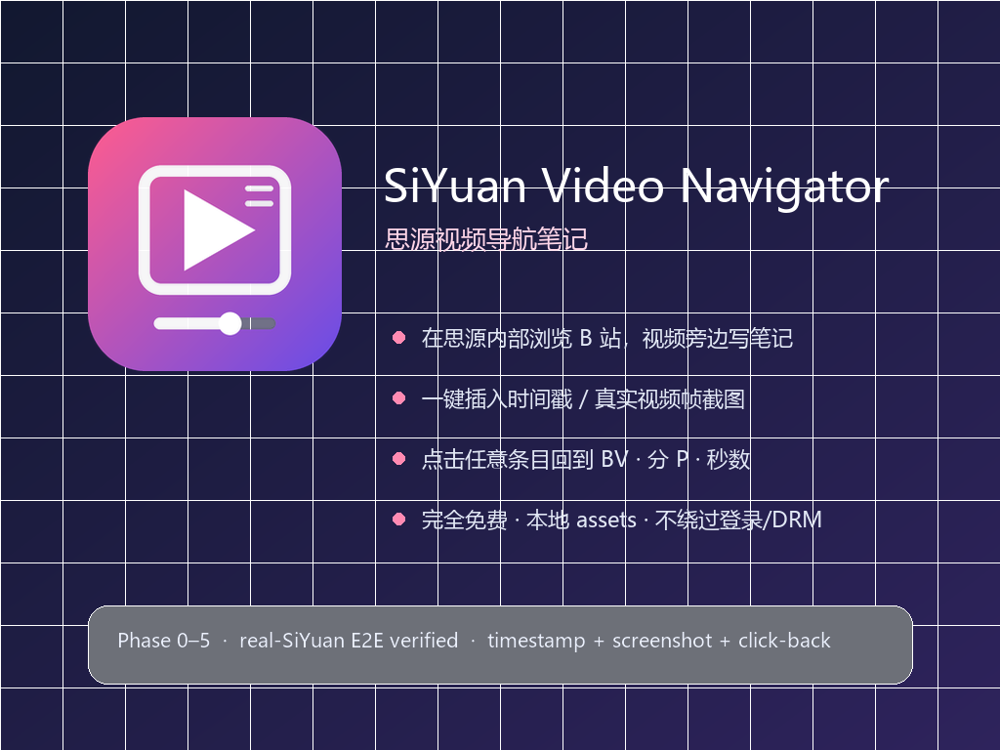

# SiYuan Video Navigator / 思源视频导航笔记

在思源笔记桌面版内部直接浏览 B 站和网盘视频，把**当前时间戳、真实视频截图、短视频片段**插入笔记；点击笔记中的时间戳或截图，可以回到原来的 **BV / 分 P / 秒数**或网盘文件位置。

> 完全免费、纯本地运行，不上传笔记、Cookie 或视频内容。
>
> 当前版本：**v0.13.7** · 适配思源 **3.8.x** 桌面版。



## 功能

- **内嵌 B 站浏览器**：地址栏、前进/后退、刷新、页面缩放。
- **时间戳笔记**：一键插入当前播放时间，点击回到原视频秒数。
- **真实截图**：捕获当前视频帧，保存到思源本地 assets，点击截图回到原位置。
- **视频片段**：录制 3/5/10/15/30 秒片段并插入笔记。
- **点击回溯**：自动恢复视频、分 P、时间点，并自动播放。
- **可配置快捷键**：时间戳、截图、片段、播放/暂停、快退/快进、打开浏览器、打开网盘、MediaKB。
- **可配置链接文本**：仅时间、时间+标题、时间+文件名、来源+时间、BV/P、图标、完整标题或自定义模板；默认截断 16 字。
- **原生网盘（实验）**：百度网盘、夸克网盘、阿里云盘；阿里云盘使用 HLS 预览转码播放。
- **持久登录**：凭据使用系统安全存储 + AES 兜底加密，重启/卡退后保留。
- **MediaKB 归档（可选）**：调用本地 MediaKB 完成语音转写、LLM 整理，并把转写稿、卡片、概念、索引导入思源笔记本；支持直接调用思源内置 AI。
- **多视频同文档**：同一篇笔记中插入多个视频的时间戳/截图，逐条回溯。

## 安装

### 方式一：安装包

从 [Releases](https://github.com/DJYDN/siyuan-video-navigator/releases) 下载最新的 `siyuan-video-navigator-*.zip`：

1. 打开思源 → 设置 → 集市 → 已下载 → 安装包；
2. 选择 zip；
3. 启用插件并重新加载界面。

### 方式二：源码构建

要求：

- Node.js 20+
- pnpm
- 思源 3.8.x 桌面版

```bash
pnpm install
pnpm run build
```

构建产物在 `dist/`，安装方式：

```bash
pnpm run make-install
```

或手动将 `dist/` 复制到思源工作空间：

```text
<workspace>/data/plugins/siyuan-video-navigator/
```

## 使用

1. 点击顶栏「视频」图标，打开 **B 站 · 视频导航** 页签；
2. 建议把页签拖到笔记编辑器旁边分屏；
3. 在笔记中点击插入位置；
4. 播放视频时按快捷键：

| 功能 | 默认快捷键 |
|---|---|
| 插入时间戳 | `Ctrl+Alt+T` |
| 插入截图 | `Ctrl+Alt+S` |
| 截取片段 | `Ctrl+Alt+C` |
| 播放 / 暂停 | `Ctrl+Alt+P` |
| 快退 3 秒 | `Ctrl+Alt+Left` |
| 快进 3 秒 | `Ctrl+Alt+Right` |
| 打开视频浏览器 | `Ctrl+Alt+B` |
| 打开网盘 | `Ctrl+Alt+N` |
| MediaKB 归档 | `Ctrl+Alt+M` |

所有快捷键都可以在插件设置中重新录制。

## 链接文本格式

设置 → 插件 → 视频导航 → 链接文本格式。

支持预设：

- 仅时间：`19:17`
- 时间 + 截断标题（默认）：`19:17 · 让天下没有难写的…`
- 时间 + 文件名
- 来源 + 时间
- 时间 + BV/P
- 图标 + 时间
- 完整标题
- 自定义模板

模板 Token：

```text
{time} {time_full}
{title} {title:20}
{filename} {filename_noext}
{provider} {bv} {p} {folder}
{duration} {date} {icon} {type}
```

默认最大 16 字，支持末尾/中间省略。只改变显示文本，不改变链接目标和旧链接。

## 原生网盘与登录

### 百度 / 夸克 / 阿里云盘

- 在「原生网盘（实验）」页签中扫码或加载官方登录页；
- 登录凭据本地加密保存，不读取、不上传 Cookie；
- 阿里云盘视频使用 HLS 预览转码，内置 `hls.js`；
- 百度/夸克使用各自的文件列表和直链解析。

> 网盘接口为私有接口，可能因官方调整而失效；使用前请了解账号风险。插件不绕过会员、DRM 或付费限制。

## MediaKB 归档（可选）

MediaKB 是一个本地的音频转写 + LLM 知识库项目，不属于本插件仓库。

在插件设置 → MediaKB 中配置：

- MediaKB 根目录
- Python 路径
- `.env`
- 转写输出目录
- 转写稿 / LLM / 概念 / 主题 / 索引笔记本

配置后按 `Ctrl+Alt+M`，输入 B 站/抖音链接或选择本地音视频，插件会：

1. 调用 MediaKB 完成下载与转写；
2. 默认使用 **思源内置 AI** 完成卡片/概念整理（无需在插件里填写 API Key）；
3. 把转写稿、LLM 卡片、概念页面和索引表导入对应思源笔记本；
4. 支持 `[[双链]]` 转换为思源引用。

如果不使用 MediaKB，B 站、截图、片段和原生网盘功能不受影响。

## 数据与隐私

- 所有数据保存在本地思源工作空间和本地 assets；
- 插件不收集遥测，不上传笔记内容；
- B 站使用独立持久化 webview 分区；
- 网盘凭据使用 Electron `safeStorage` + 机器绑定 AES 兜底加密；
- MediaKB 任务只在本地调用 Python 和思源 AI API；
- `.env`、API Key、Cookie 不会提交到本仓库。

## 开发

```bash
pnpm install
pnpm run check
pnpm test
pnpm run build
```

主要目录：

```text
src/browser/     B 站 webview 适配
src/notes/       时间戳/截图/片段/点击回溯
src/cloud/       网盘驱动、代理、凭据与挂载
src/mediaKB/     MediaKB 任务、导入、思源 AI 桥接
src/ui/          页签 UI
public/          静态资源
tests/           单元测试
```

## 已知限制

- 仅支持思源桌面版；移动端不可用；
- 原生网盘为实验功能，私有 API 可能随时变化；
- 阿里云盘 HLS 依赖官方预览转码，部分文件可能无转码；
- MediaKB 转写需要本地 Python、ffmpeg 和模型文件；
- CPU 转写时间取决于音频长度和机器性能；
- 不提供 B 站/网盘内容下载、去广告或绕过付费功能。

## License

本项目使用 **MIT License**。第三方组件与许可证见 [THIRD_PARTY_NOTICES.md](THIRD_PARTY_NOTICES.md)。

## 免责声明

本项目是第三方非官方插件，与思源笔记、哔哩哔哩、百度网盘、夸克网盘、阿里云盘均无隶属或合作关系。请遵守各平台服务条款，仅将截图、转写和笔记用于个人学习/研究。
